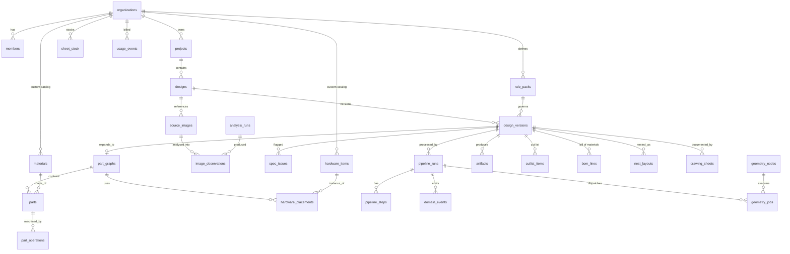

# 01 — Domain model (DDD) and ERD

## 1. Ubiquitous language

Use these words in code, UI, prompts and conversations with workshops. If the code says `side_panel` and the workshop says *gable*, the code is wrong.

| Term | Meaning |
|---|---|
| **Carcass** (carcase) | The box of a cabinet: gables, top, bottom, back, fixed shelves. |
| **Gable** | Vertical side panel of a carcass. `gable_left`, `gable_right`; `divider` when internal. |
| **Top / Bottom** | Horizontal carcass panels. Construction is either **top-over-gables** (top sits on gables, full width) or **gables-over-top** (top fits between gables). Captured as `JoineryStyle`. |
| **Back** | Back panel: `inset_groove` (sits in a groove, typically 3–8 mm HDF), `rebated`, `applied` (nailed on), or `full_thickness` (18 mm structural). |
| **Plinth / Kickboard** | Toe-kick base; or **adjustable legs** with a clip-on kickboard. |
| **Front** | Door or drawer front. `overlay` (full / half) vs `inset`. Gap (reveal) usually 2–3 mm. |
| **Section** | A vertical bay of a cabinet between two gables/dividers. A wardrobe = N sections. |
| **Compartment** | A cell inside a section (shelf space, hanging space, drawer stack). |
| **Finished size** | Size after edge-banding. **Cut size** = finished size − band thickness on banded edges (+ pre-mill allowance if the edgebander pre-mills). |
| **Edge banding** | Tape applied to panel edges; spec'd per edge (`L1 L2 W1 W2`), thickness 0.4 / 1 / 2 mm. |
| **Grain** | Direction constraint: `length`, `width`, `none`. Locks rotation during nesting. |
| **32 mm system** | Line-bore holes Ø5 on a 32 mm pitch, front row 37 mm from front edge. Used for adjustable shelves and hinge plates. |
| **Hardware** | Hinges, slides, connectors (minifix/cam, dowel, confirmat), handles, legs, hanging rails, shelf pins. |
| **Operation** | Machining on a part: `drill`, `groove`, `pocket`, `cutout`, `edge_profile`. Positioned in **part-local coordinates** on a named **face**. |
| **Rule pack** | A versioned set of manufacturing rules for a workshop (material thicknesses, back style, hinge brand, min/max sizes, clearances). |
| **Spec** | `FurnitureSpec` — the design *intent*. Editable by humans. Small. |
| **PartGraph** | The fully expanded manufacturable model: parts, operations, hardware placements, joints, assembly tree. Generated, never hand-edited. |
| **Production package** | Zip of `.skp`, drawings PDF, DXFs, cut list CSV/XLSX, BOM, CNC programs, labels. |

## 2. Bounded contexts and aggregates

```
┌──────────────── Tenancy ─────────────────┐    ┌──────────────── Catalog ────────────────────┐
│ Organization (AR)                        │    │ Material (AR)  SheetStock  EdgeBand          │
│  └ Member (role: owner|designer|shop)    │    │ HardwareItem (AR)                            │
└──────────────────────────────────────────┘    │ RulePack (AR, versioned, immutable once used)│
                                                └──────────────────────────────────────────────┘
┌──────────────────────────── Design (core domain) ────────────────────────────────────────────┐
│ Project (AR)                                                                                │
│ Design (AR)  ── has many ──► DesignVersion (entity, immutable after approval)               │
│   │                             ├ FurnitureSpec (value object, JSON)                         │
│   │                             ├ SpecIssue[] (value objects from Rule Engine)               │
│   │                             ├ PartGraph (value object, JSON + denormalised Part rows)    │
│   │                             └ Artifact[] (refs)                                          │
│   └ SourceImage[] ── ImageObservation[] (Perception output)                                  │
└─────────────────────────────────────────────────────────────────────────────────────────────┘
┌──── Orchestration ────┐  ┌──── Manufacturing ───────────────┐  ┌──── Documentation ────┐
│ PipelineRun (AR)      │  │ CutList (VO of version)          │  │ DrawingSet            │
│  └ PipelineStep       │  │ BOM (VO)  NestLayout  CncProgram │  │  └ DrawingSheet       │
│ DomainEvent (outbox)  │  └──────────────────────────────────┘  └───────────────────────┘
└───────────────────────┘
┌──── Geometry ─────────┐
│ GeometryJob (AR)      │
│ GeometryNode          │
└───────────────────────┘
```

**Aggregate invariants**

- `Design`: at most one *draft* version at a time; versions are numbered monotonically; an approved version is frozen (spec, rulepack_version, generator_version, graph_hash can never change — enforced by a DB trigger).
- `DesignVersion.approve()` only allowed if `SpecIssue` list contains no `severity=error`.
- `RulePack`: once referenced by an approved version it's immutable; edits create `version+1`.
- `PipelineRun`: one active run per DesignVersion.
- `PartGraph`: every part has a material in the org catalog; every operation lies inside its part's bounding box; every hardware placement references existing parts; Σ part volumes ≈ derived from spec within tolerance (sanity check).

**Domain services** (pure functions where possible)

| Service | Signature |
|---|---|
| `SpecValidator` | `(spec, rulepack, catalog) → list[SpecIssue]` |
| `SpecNormalizer` | `(spec, rulepack) → spec` (snap to 32 mm grid, round to mm, fill defaults) |
| `ParametricGenerator` | `(spec, rulepack, catalog) → PartGraph` — dispatches on `spec.category` |
| `CutlistService` | `(PartGraph, catalog) → CutList` |
| `BomService` | `(PartGraph, CutList, catalog, price_list) → BOM` |
| `Nester` | `(CutList, sheet_stock, kerf, trim) → NestLayout` |
| `CncPostProcessor` | `(Part, NestLayout?) → CncProgram` (per machine dialect) |
| `DrawingService` | `(PartGraph, spec, template) → DrawingSet` |

## 3. Spec ↔ PartGraph boundary (why two models)

| | FurnitureSpec | PartGraph |
|---|---|---|
| Producer | LLM + human | Deterministic generator |
| Size | ~1–5 KB | 20–500 KB |
| Granularity | "wardrobe 2400×2600×600, 3 sections, section 2 = hanging + 2 drawers" | "part #17 `drawer_side_L_s2_d1`, 450×120×16 white melamine, band L1 1 mm, 4× Ø8×10 dowel holes at…" |
| Editable by user | Yes (Review UI) | No — regenerate |
| LLM can see it | Yes (writes it) | No (too large, LLMs miscount) |

Keeping the LLM at the Spec level is the single most important accuracy decision in this system.

## 4. ERD



Full DDL: [supabase/migrations/0001_init.sql](../supabase/migrations/0001_init.sql).

### Storage choices

- `FurnitureSpec` and `PartGraph` are stored **as JSONB** (the canonical document, hashed) *and* the PartGraph's parts are **denormalised into `parts` / `part_operations`** rows so cut lists, search ("all designs using Egger W1000"), and analytics are plain SQL.
- Binary files live in Supabase Storage with path convention
  `org/{org_id}/design/{design_id}/v{n}/{kind}/{sha256}.{ext}`; the `artifacts` table is the registry.
- Multi-tenancy: every table has `org_id`; RLS policies use `auth.jwt() ->> 'org_id'` from the Clerk session token (Clerk is configured as a Supabase third-party auth provider and puts the active org in a custom claim). The FastAPI backend uses the service role and enforces tenancy in the repository layer as well — **defence in depth**, because workers bypass RLS.

## 5. Contract generation

Pick one source of truth and generate the rest:

1. Hand-write Pydantic v2 models in `python/df_domain` (best ergonomics for validators).
2. `just schemas` exports `model_json_schema()` → `schemas/*.schema.json`.
3. `json-schema-to-typescript` → `packages/contracts/src/generated/*.ts`.
4. FastAPI's OpenAPI → `openapi-typescript` → typed web client.
5. CI fails if regenerated files differ from committed ones (`git diff --exit-code`).

The same JSON Schema is passed to the LLM as the **structured output schema** (OpenAI `text.format: json_schema, strict: true`; Claude tool `input_schema`). One schema, four consumers.

The hand-written TS in `packages/contracts/src` in this repo shows the intended shape before generation is wired.
